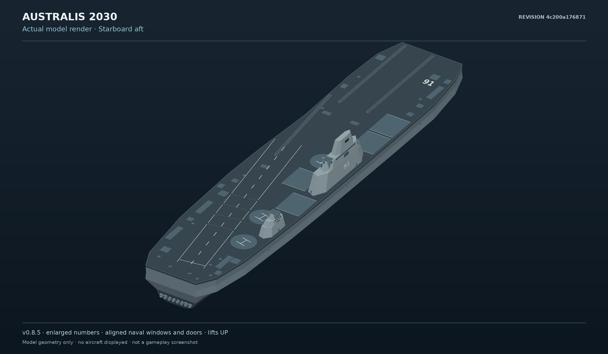
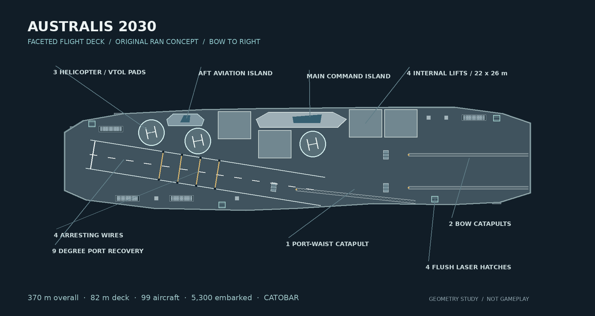
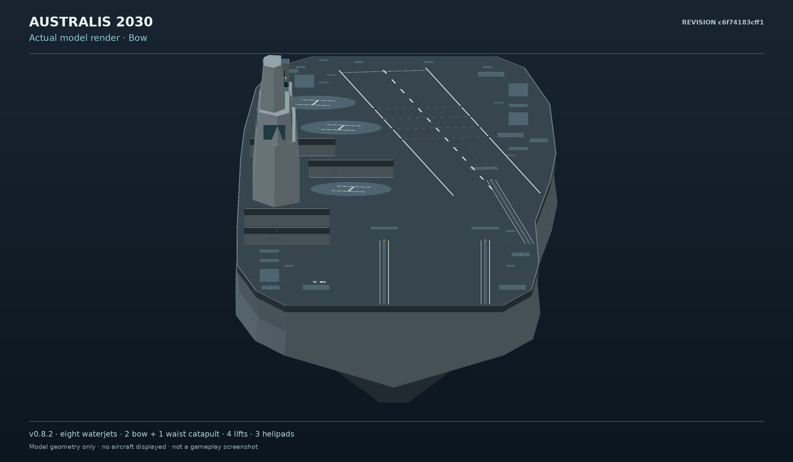

# Royal Australian Navy carrier game design

## Current focus: Australis 2030

We are refining the newest Australis first, then moving backward through its earlier concepts. The original 2030 silhouette, editable model source, deck plan and rendered preview are in [australis-2030](australis-2030/README.md).

[Open the current model photos and 3D viewer](australis-2030/viewer/australis_2030_3d.html). The first tab contains four current model renders; **Rotate 3D model** lets you inspect the same deck, radar panels and laser hatches. Use **Deploy four lasers** to see the raised visual state. Download the self-contained HTML file to open it offline.

The current Australis is a **steam CATOBAR carrier** with five 95 m launch
tracks: **three at the bow and two angled on the port waist**. It retains the original two
islands, four offset helicopter/VTOL spots, four 22 × 26 m lifts and an angled
recovery deck with arresting cables. A broader bow deck follows the supplied
Ford reference while the immersed bow remains fine. Bow lanes 1/3 can operate
as a pair; the centre bow lane interlocks with its neighbours. Waist lanes
4/5 use a shallow 6-degree port heading and staggered launch positions; they
interlock with all bow lanes and each other. Flush metal slots, small shuttles,
white guides and segmented stowed deflectors replace the plain yellow bars.
All five catapults and the arrested-recovery point accept Plane, VTOL and
STOL types. The four vertical spots accept Helicopter and VTOL types. Aircraft
discovery remains automatic, with no carrier-specific class whitelist or
size, role or loadout exclusions. Aircraft must be correctly installed and
carrier-capable, including their squadron definitions; the air group starts
empty and requires no aircraft pack. The port lift stays beside the aft part
of the main island at z=-32 m. The helicopter spots form two pairs ahead of
the islands; all four interlock with the waist lanes while leaving the bow
bank available during vertical launches. Every recovery point explicitly
blocks all nine launch points. The smaller aft island has
wraparound glazing. Arrested recovery uses a 9-degree port axis with four
perpendicular wire indications.

The outer waist track is moved 6.2 m inboard to clear the larger reference
footprints on its aligned taxi approach. All five catapults are checked at
staging and 20 m behind the launch point using A-7E, F-14A and a 25 m span ×
30 m length reference envelope against deck, lift and island footprints.
These checks support broader eligibility; swept taxi turns, rotor clearances,
individual add-on aircraft and mixed deck cycles still need in-game QA.

Design targets are **370 m overall, 82 m main flight deck, 112,000 metric
tonnes, 99 aircraft and 5,300 embarked personnel**, with 5,800 berths. Maximum
width including the lifts is 109 m. The [design basis](australis-2030/DESIGN-BASIS.md)
sets out the crew, space and mass allocations and distinguishes them from
verified game behaviour.

The Ford/Zumwalt-inspired fit has 80 peripheral VLS cells, two self-defence
launchers, two 21-position RAM-form launchers, three Phalanx mounts, two 30 mm
guns, conformal radar faces, ESM, defensive/offensive ECM, SRBOC and two Nixie
decoys. Available stock profiles provide explicitly declared compatibility
proxies: the ESSM/RAM-form mounts currently fire **RIM-7M Sea Sparrows**.
The VLS banks now also carry RIM-7M defensive proxies; **RIM-66E and RGM-109
are removed**. Four VLS banks and four missile housings are on the marked
main-deck edge positions, with matching no-parking zones.
SPY-1A represents the modern search-radar role. Nulka and retractable lasers
remain visual positions. This is an original game design, not an exact Ford
or Zumwalt simulation.

The reported normal-gun aiming error is corrected by registering real
barrels and supplying the engine-required `NumberOfGuns`/`Gun1` fields.
All five guns now have original moving yaw/elevation objects. Aircraft
taxi/launch coordinates match the deck surface, removing the former 16 cm
offset. The rebuild also makes the lift surfaces nearly flush, reduces the helipads to
painted surfaces and lowers thick deck markings and stowed covers. Aircraft
contact points follow the actual exported surfaces. The finite aviation
reserve is **6,000,000 supply points**, with no
per-category limits; stock aircraft gun capacities are preserved. These gun
and contact-height corrections pass static checks and need in-game verification.

The user confirmed mission loading and original hull rendering with `cbdaef4`
on 22 October 2026 after the missing `[Foam]` configuration was added. The new
five-lane/combat revision passes static geometry, references, size/budget and
installer checks, and **still needs in-game flight and combat testing**.
The installer checks stock dependencies before staging the independent
[game package](game-mod/RAN-Carrier-Australis-2030/). See [upgrade, test and
rollback steps](australis-2030/GAME-TEST.md). RADF, Workshop, original game files
and User Data are not modified. The earlier 14 fleet studies remain below.

The [current model photos and 3D viewer](australis-2030/viewer/australis_2030_3d.html)
display the same model revision. Four matching model renders are embedded
in the standalone HTML and available as PNGs in `australis-2030/previews/`.
They show the actual empty-air-group design mesh; the earlier photorealistic
concept image included finishing details and aircraft absent from the model.

## Earlier fleet studies

Fourteen original Sea Power carrier **designs** covering every edition in the brief. The models and gameplay figures are proposals for an alternate-history RAN fleet. They are not tested as a playable mod.

| Era | Proposed class | Propulsion | Aircraft | Offensive ECM | Laser |
|---|---|---|---:|---|---|
| 1940s early | Endeavour | Steam | 30 | — | — |
| 1940s late | Sydney | Steam | 30 | — | — |
| 1950s early | Melbourne | Steam | 30 | — | — |
| 1950s late | Melbourne | Steam | 30 | — | — |
| 1960s early | Australia | Steam | 68 | — | — |
| 1960s late | Federation | Nuclear | 68 | — | — |
| 1970s early | Federation | Nuclear | 69 | 1 shipboard | — |
| 1970s late | Canberra | Nuclear | 69 | 1 shipboard | — |
| 1980s early | Commonwealth | Nuclear | 98 | 1 shipboard | — |
| 1980s late | Commonwealth | Nuclear | 98 | 1 shipboard | — |
| 1990s early | Commonwealth | Nuclear | 98 | 1 shipboard | — |
| 2000s early | Southern Cross | Nuclear | 98 | 1 shipboard | — |
| 2000s late | Southern Cross | Nuclear | 98 | 1 shipboard | — |
| 2020s early | Australis | Nuclear | 99 | 1 shipboard | 4 mounts (concept) |

Each edition has a separate design sheet with the proposed air group, dated combat systems and hull dimensions. `design-manifest.json` provides machine-readable values, including a single carrier-mounted offensive ECM module from 1972 onward. ECM uses no aircraft slots and there is no carrier-dedicated EF-111N aircraft. The 2023 hull has four visible laser mount studies; beam weapon logic and effects need implementation and testing.

`metre-source-models/` holds the original OBJ/MTL authoring coordinates. `game-scale-models/ships/` holds approximately scaled copies using one observed Sea Power OBJ reference ratio, with the same object groups (Hull, FlightDeck, elevators, catapult markings, ECM and laser mounts). `previews/` are geometry renders, not screenshots. `generate_source_models.py` rebuilds the original metre models from `fleet-source.json` with Python, NumPy and Pillow; `rebuild_game_scale.py` recreates the approximate game-scale OBJ copies from the packaged metre sources. The design manifest remains the editable source of the gameplay proposals.

`draft-ini/` has Sea Power-shaped **reference templates**, including eight original ECM sensor profiles with native-style `Kind=ECM` and `Type=Offensive` fields. The files deliberately end in `.draft.ini`. Do not copy them into the live game's `StreamingAssets/user` tree. They omit engine-required taxi paths, launch/recovery points, collision, animations, damage models, materials, aircraft IDs, weapon mounts, sonar routing and an operational laser. Ship propulsion labels are design requirements; the game's native nuclear-power type remains to be confirmed. Numeric ECM performance is proposed game balance, constrained in practice by jamming and horizon calculations.

The 1944–1959 light fleet series follows British wartime light-carrier design cues. The 1963–1993 hulls draw from US conventional and nuclear supercarrier lineages but have newly authored Australian silhouettes and fittings. The 2002–2023 Southern Cross and Australis hulls have distinct Australian decks, islands and sensor/weapon outlines. No third-party hull geometry, textures or INIs are included. `CREDITS.md` records the provenance of the one external scale reference.

The Australis editor test uses the supplied smaller reference archives of stock Forrestal/Nimitz and Workshop carrier INIs to map lifts, taxi, launch and recovery sections against the original Australis mesh. The supplied Sea Power copy was used to inspect `Seapower-Scripts.dll` and trace the rudder loading error; game binaries and third-party assets are not included here. The prototype leaves its air group empty for user-selected aircraft and now includes a declared stock-compatible combat trial. Source design geometry may require reshaping for physically safe deck cycles. No in-game flight, radar, sonar, ECM or laser tests have been claimed.

## Source notes

- Sea Power carrier INI format, navigation fields and ECM key names were checked against the local Project Southern Cross examples supplied earlier in this conversation. They are used as schema reference only.
- The [Project Southern Cross Workshop page](https://steamcommunity.com/sharedfiles/filedetails/?id=3574957049) credits Peter Garrett. Specific third-party models would require their own permission and contributor checks if incorporated later.
