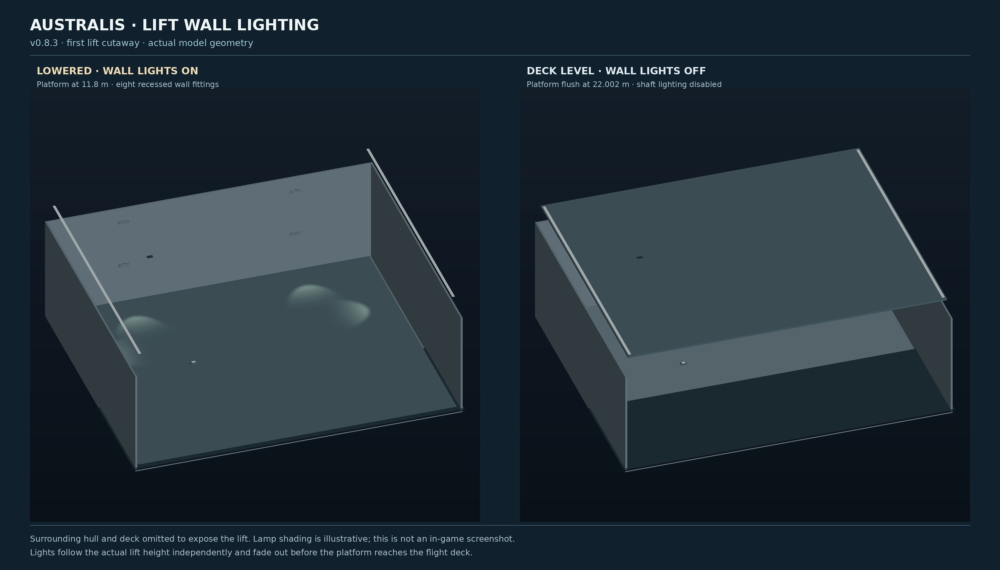

# Australis 2030 — v0.8.5 Naval Details

Australis is an original alternate-history carrier for Sea Power. Four named ships share the native class: **HMSCS Australis 91, Southern Cross 92, Federation 93 and Commonwealth 94**. This experimental release updates their naval detailing; current Unity appearance and live aircraft/combat behaviour still need in-game confirmation.

## Naval details

Hull numbers **91–94** are enlarged on the flight deck and both main-island sides and aligned to their model surfaces. The shared native class still selects the matching number atlas for each named ship. Both bridge structures receive individual framed naval-style windows, with consistent sill heights and mullions on their actual raked faces. Watertight-style doors use raised coamings, rounded corners, hinges, dogs and handles aligned to the supporting surface.

The deck number panel is **10.8 × 8.8 m**, with an approximately **8.44 × 6.53 m** painted glyph. Both port and starboard main-island panels are **9.6 × 5.6 m**, with approximately **7.69 × 4.20 m** glyphs. The panels follow their actual supporting planes with a small surface offset; the enlarged island markings sit between the lower access doors and bridge glazing.

These fittings are original decorative model geometry; they do not create functioning doors or establish watertight integrity, ballistic protection or naval-design certification. Their appearance, texture orientation and visibility still need an in-game check. The change retains the preceding hull, waterjet, class-list and flight-deck configuration.

[Full-ship render](previews/Australis-v0.8.5-Full-Ship.png) · [Naval-detail close-up](previews/Australis-v0.8.5-Naval-Details.png) · [Numbering views](previews/Australis-v0.8.5-Hull-Numbers.png) · [Four-ship 3D viewer](viewer/Australis-v0.8.5-Fleet-3D.html) · [Release notes](releases/v0.8.5/README.md)

Download and open the self-contained HTML locally. It uses the current exported OBJ and INI geometry, with number appearance projected from the same per-variant PNG atlases as the game. Preview texture sampling and studio shading are approximations; they do not simulate Unity lighting or native flight scheduling.

## Install the current build

[Download the v0.8.5 offline installer](../builds/install-ran-australis-v0.8.5-naval-details-offline.sh?raw=1), save it in Downloads, close Sea Power and run:

```bash
bash "$HOME/Downloads/install-ran-australis-v0.8.5-naval-details-offline.sh"
```

The complete offline installer requires Python 3 and verifies its embedded package. Alternatively, download the smaller [network installer](../builds/install-ran-australis-v0.8.5-naval-details.sh?raw=1); it requires an internet connection and reconstructs the same verified release:

```bash
bash "$HOME/Downloads/install-ran-australis-v0.8.5-naval-details.sh"
```

Wait for **100%** and `installed package hashes verified`. Enable **AnchorChain** and **RAN Australis Fleet v0.8.5 Naval Details**, disable older Australis entries, restart and place a fresh carrier. No earlier installer is required. The installer verifies its embedded archive and manifest, backs up the previous build and supports `--check`, `--restore BACKUP_DIRECTORY` and `--remove`. [Complete test and rollback guide](GAME-TEST.md).

The v0.8.4 class and flight-deck fixes are retained: one **Australis-class** entry has all four native variants, all four lifts idle at **22.002 m** and lower on demand, and **22 taxi routes** serve the three catapults and three helicopter-only pads. The compiled deck controller remains v0.8.2. Older missions using the former Southern Cross, Federation or Commonwealth vessel IDs need those ships re-placed from the consolidated class; saved missions are not rewritten.

## Current configuration

| Item | Current configuration or design target |
|---|---|
| Overall length / main flight-deck width | 370 m / 82 m |
| Waterline length / beam / maximum draft | 362.6 m / 41 m / 11.5 m |
| Net geometric wet-hull displacement | Approximately 112,000 t, including flooded-duct deductions |
| Aircraft / embarked personnel / berths | 99 / 5,300 / 5,800 planning targets |
| Hangar | 280 × 50 × 8 m; 36 folded reference parking boxes |
| Steam catapults | Three 95 m tracks: two bow and one port waist |
| Lifts | Four internal 22 × 26 m platforms; all four support fixed-wing routes; upper idle/home stop; six-second native travel |
| Helicopter pads | Three, Helicopter only; preference aft, then front, then middle |
| Operating speeds | **Standard 20 kn**, **Full 30 kn**, Flank 30 kn |
| Repair teams | Five native damage-control teams |
| CIWS | Five retractable mounts: three deck wells and one on each island |
| VLS stores | 40 stock RIM-66E proxies and 40 stock RIM-7M rounds |

The forward CIWS sits outboard of the bow catapult at the corrected port-side position. The flight deck retains its nine-degree port recovery axis, four arresting-wire indications, deck markings, tyre streaks, bridge panes, naval doors and painted hull numbers.

## Aviation at Standard power

**Standard is 20 knots** for normal aircraft and helicopter operations; Full reaches the existing 30-knot ceiling for emergency manoeuvring. This is an operating convention, not an automatic emergency detector. The native speed ladder is `-7,0,6,12,20,30,30` for Astern, Stop, Creep, Slow, Standard, Full and Flank. Maximum speed and the 280,000-horsepower power setting are unchanged.

All four lifts serve fixed-wing operations through the corrected catapult and arrested-recovery routes. The three helicopter-only pads retain their designated native lift routes; VTOL/STOL aircraft use the rolling aircraft paths. Installed carrier-capable aircraft are discovered without a carrier-specific class whitelist or size, role or loadout exclusion. This includes correctly configured F-111N add-ons; it does not establish physical clearance for every aircraft or loadout. The air group starts empty for user selection.

The three helicopter pads can operate independently when their native routes are free. Shared lifts and taxi/recovery lanes still queue, and recovery retains its configured conflicts. The full 99-aircraft parking and operating cycle remains unverified.

## Lift-wall lighting

Each shaft has eight recessed warm-white wall lights, **32 in total**, on its outer, forward and aft walls. The inboard hangar doorway stays open. Each group follows its actual platform height and operates during the day and at night:

- At the lower stop, 11.8 m, the shaft lights remain on.
- Lights fade as the platform approaches the 22.002 m flight-deck stop.
- They are fully off within 0.10 m of deck level and reach full brightness at 0.60 m below it.

The fixtures stay outside the platform sweep. Their spotlights point inward and downward; the lenses have no permanent emission. Missing or invalid platform data switches the affected group off. Exterior night lighting remains controlled separately.



The cutaway uses actual geometry with illustrative lamp shading. In-game brightness, appearance and light leakage still need a visual check.

## Waterjets and defensive systems

Eight real underside intake openings connect through internal wet ducts to eight open transom outlets. Four outer nozzle assemblies steer together through native rudder pivots; the four inner outlets are fixed booster representations. Sea Power uses its aggregate vessel-propulsion model: independent jet thrust, booster staging, reverse-bucket actuation and eight separate wakes are not simulated.

The [engineering review](../WATERJET-ENGINEERING-REVIEW.md) records the geometric hydrostatics and power sensitivity. Approximately 900.4 m³ of floodable ducts are deducted in the net wet-hull calculation. Actual resistance, pump selection, cavitation, machinery weights, full stability, structures and real 30-knot performance remain unresolved.

The 80 VLS cells use declared stock compatibility proxies. RIM-66E retains its stock guidance and target limits; it is **not SM-6**, and no ballistic-missile defence capability is claimed. The ESSM/RAM-form launchers also use declared stock proxies. Nulka and laser positions remain visual studies.

The AnchorChain deck controller waits for committed aviation to clear before opening the defensive wells, deploys over 0.75 simulation seconds, holds for 300 seconds after the last actual shot, and stows over 10 seconds. Aviation stays interlocked until stowage completes. Actual combat and mixed deck operations require in-game testing.

## Source and checks

The current source is rebuilt from the recoverable v0.5.1 base and subsequent design changes; it is not a byte-for-byte restoration of the lost v0.6.0 installer. The current driver is:

```bash
python3 tools/rebuild_recovery.py
python3 tools/validate_recovery.py
```

Source generation uses NumPy, Pillow, Shapely and SciPy; preview plots also use Matplotlib. Recompiling the controller requires an external .NET SDK and official AnchorChain/Harmony development references; see [GAME-TEST.md](GAME-TEST.md). The delivered installer uses Python's standard library only. Game binaries and third-party asset bytes are not redistributed.

Checks cover exported hull topology and openings, native bindings, internal reservations, aircraft routes, lift animations, the speed ladder, 193 lighting policy/reflection checks and transactional installation/rollback. These establish geometry and software integrity, not completed Unity rendering, flight, combat or naval-engineering validation. Historical release notes remain under [releases](releases/) and [builds](../builds/README.md).
